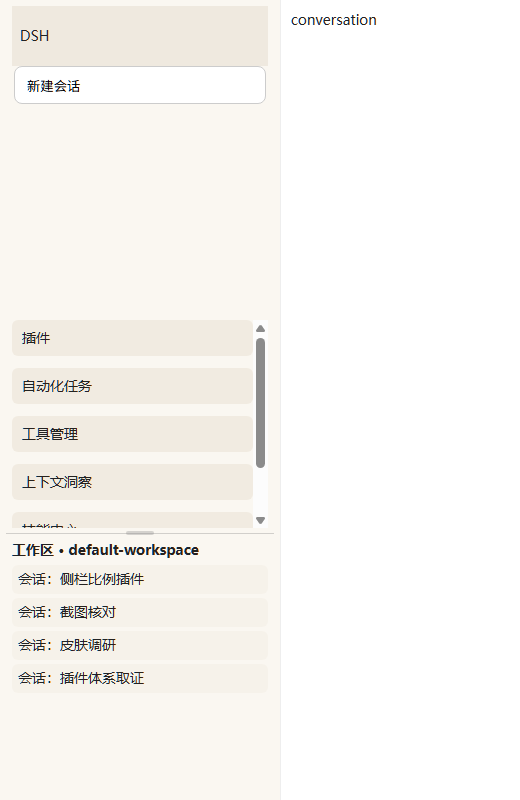

# dsh-sidebar-split

> 给 DSH（DeepSeek Harness）的侧栏加一条**可拖动的水平分隔线**，
> 在「工具 / 面板列表」和「工作区 + 会话列表」之间分配高度。



*上图是 `test/fixture.html?skin=1` 的渲染结果（模拟 orca-link 皮肤把面板列表整体下推 204px）：
工具列表按 45% 封顶并自带滚动条，下方「工作区 · 4 条会话」依然可见。*

## 它解决什么问题

DSH 原生侧栏把面板列表写成固定高度、会话区写成 `flex:1`：

```css
.panelList  { flex: none; }                                  /* 工具 / 面板项，多高就占多高 */
.regionArea { flex: 1; min-height: 0; overflow: hidden; }     /* 工作区 + 会话列表 */
```

于是当工具项变多、或者皮肤给顶部品牌区预留了立绘舞台，`regionArea` 会被压到 `0`，
**整个会话列表消失**——插件装得越多越容易撞上。本插件把面板列表改成
「按比例封顶 + 自身可滚动」，会话区永远留够 `minSessions`。

## 安装

```bash
# 从 npm
dsh plugin --profile desktop add dsh-sidebar-split

# 或者从本地目录软链（开发用）
dsh plugin --profile desktop add link:<本仓库绝对路径>
```

装完**重启一次 DSH**：新增的 bundle 层只在启动时组合。

> `--profile web` 同样可用；不加 `--profile` 时使用默认 profile。

## 使用

| 操作 | 效果 |
| --- | --- |
| 拖动侧栏里的分隔线 | 实时分配面板列表 / 会话区高度 |
| `Alt` + `Shift` + `↑` / `↓` | 面板列表 −3% / +3%（`↑` = 多给会话区） |
| `Alt` + `Shift` + `0` | 回到配置里的默认比例 |
| 双击分隔线 | 同上 |
| 控制台 `dshSidebarSplit.set(0.3)` | 面板列表占可用高度的 30%（写 `30` 也按百分数处理） |

分隔线常驻可见：一条 1px 细线 + 中间 28×4 的小胶囊抓手；鼠标靠近时抓手变宽（44×4）、线条变实，
拖拽时保持高亮。比例存在浏览器 `localStorage`（key `dsh.sidebar-split.v1`），刷新后保持，
不写任何磁盘文件。

## 配置

改 `cordis.patch.yml` 的 `config`，**改完需要重启 DSH**：

```yaml
- insert:
    - id: sidebar-split
      name: 'dsh-sidebar-split'
      config:
        share: 0.45        # 面板列表占「面板列表 + 会话区」可用高度的比例
        minTools: 96       # 面板列表像素下限
        minSessions: 140   # 会话区像素下限
        enabled: true      # 总开关；false = 完全不接管（页面里也改不回来）
```

可用高度 = 侧栏内容盒高度 − 面板列表上方的所有内容（logo、新建会话按钮、皮肤预留的舞台）− 底部区域；
面板列表与会话区之间的外边距不参与分配。

## JS API

页面里挂了一个 `window.dshSidebarSplit`：

| 方法 | 说明 |
| --- | --- |
| `get()` | 当前状态：`share` / `enabled` / `collapsed` / `contentH` / `above` / `footH` / `gap` / `available` / `budget` / `tools` / `sessions` |
| `set(share)` | 设置比例（`0.45` 或 `45` 都行），立即生效并持久化 |
| `reset()` | 回到配置里的 `share` |
| `enabled(bool)` | 临时开关；`false` 时清掉所有内联样式，交还原生布局 |
| `refresh()` | 重新查找节点并重排（侧栏 DOM 被重建后手动救急用） |
| `version` | 字符串版本号 |

排查「会话区还是没出来」时，先看 `get()` 里的 `available` 和 `budget`：如果是 `0`，
说明侧栏可用高度本身已经不够，该查皮肤或窗口高度。

## 实现方式

- **只做一处注入**。宿主半边通过 `webserver/index-inject` 事件推两行：一个 `global`
  （默认配置）和一个 `script`（`lib/split.js` 原文）。因此**改 `lib/split.js` 只需刷新页面**，
  不用重启 DSH。
- **不插入 React 托管的节点**。只给 `nav[class*="panelList"]` 写内联 `max-height` / `overflow-y`；
  可视分隔线挂在 `<body>` 上且 `pointer-events: none`，React 重渲染不会把它踢掉或报错。
- **按 rect 差分算高度**，不写死数值。皮肤会把面板列表整体 `margin-top` 下推几十到两百像素，
  还有折叠导轨、窗口缩放、底部区域高度变化，写死任何一个数都会错位。
- **双夹**：先按比例算，再夹到 `[minTools, budget − minSessions]`，最后硬夹到 `[0, budget]`，
  空间实在不够时也不会把会话区挤成负数。
- **健壮性**：`MutationObserver`(body) + `ResizeObserver`(root / nav / region) + `window.resize`，
  外加 1.5s 自愈轮询；`__dshSidebarSplitBooted` 保证重复注入只跑一次；侧栏折叠（宽度 < 90px）
  或找不到节点时自动退回原生行为。
- **注入前校验**：`lib/split.js` 里若出现 script 结束标签字面量，宿主会跳过注入并告警——
  宁可插件不生效，也不能把页面结构撕开。

## 兼容性

| 项目 | 说明 |
| --- | --- |
| DSH | `>= 0.2.1-rc.1`（desktop / web profile 均可） |
| 皮肤 | 按 rect 计算，与 orca-link 等会改动侧栏外边距的皮肤共存 |
| [dsh-sidebar-ratio](https://www.npmjs.com/package/dsh-sidebar-ratio) | 不冲突：它管三列**宽度**，本插件管侧栏内部**上下**比例 |
| 其它侧栏插件 | 若插槽给面板列表塞了很多项，正是本插件的用武之地 |

## 开发

```bash
npm run check        # 语法检查（lib/index.js、lib/split.js）
npm test             # 18 项 DOM 断言（手写 DOM 桩，不需要浏览器）
```

视觉回归（需要 Chrome / Edge）：

```bash
# 模拟皮肤把 nav 下推的情形；加 ?off=1 看原生布局对照组
chrome --headless=new --window-size=520,800 --virtual-time-budget=4000 \
  --screenshot=test/final_skin.png \
  "file:///<本仓库绝对路径>/test/fixture.html?skin=1"
```

仓库结构：

```
lib/index.js        宿主半边：读 split.js、注入 global + script 两行
lib/split.js        浏览器端控制器：测量、拖拽、快捷键、持久化
cordis.patch.yml    bundle 声明（id / name / 默认 config）
test/logic-test.mjs DOM 断言（Node，无浏览器）
test/fixture.html   复刻真实侧栏 DOM/CSS 的视觉回归页
docs/preview.png    README 用的截图
PUBLISHING.md       发 npm / 建仓库的检查单
```

## FAQ

**为什么不用 client bundle（`window.__ModuleLoader__`）？**
本插件不渲染任何 React 组件，只需要在页面里跑一段脚本；`index-inject` 路线更轻，
而且改脚本不用重启宿主。代价是没有官方的 React 上下文，只能靠类名后缀定位节点。

**类名是哈希的（`wtg9ga_panelList`），会不会升级就失效？**
选择器只用后缀匹配（`nav[class*="panelList"]`、`[class*="regionArea"]`），哈希前缀变了也不影响。
真正会失效的是 DSH 改掉这两个组件的 DOM 结构，那时需要同步更新 `lib/split.js` 里的选择器常量。

**会不会和侧栏的拖拽调宽打架？**
不会。本插件的指针手势只在分隔线上下 8px 内接管（`setPointerCapture`），其余区域完全放行。

**收起成导轨（56px）时为什么没效果？**
宽度 < 90px 时插件主动退回原生行为，展开后自动恢复。

## English

Split the DSH sidebar vertically: drag the divider between the panel list (plugins, tasks, tools, …)
and the workspace/session list. The panel list is capped to a share of the available height and
scrolls on its own, so the session list can never be squeezed to zero — a common accident once you
install enough plugins or use a skin that reserves the top of the sidebar.

```bash
dsh plugin --profile desktop add dsh-sidebar-split   # restart DSH afterwards
```

Drag the divider, or use `Alt+Shift+↑/↓` (3% steps), `Alt+Shift+0` / double-click to reset,
`dshSidebarSplit.set(0.3)` from the console. Defaults live in `cordis.patch.yml`
(`share`, `minTools`, `minSessions`, `enabled`); the chosen ratio is stored in `localStorage`.

## License

[MIT](LICENSE)